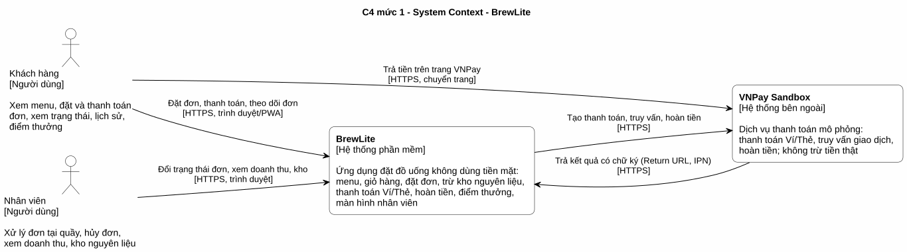
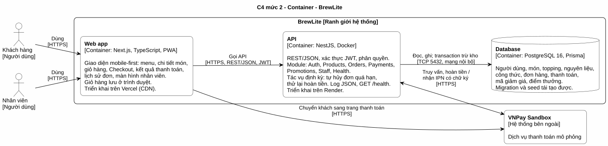

# Kiến trúc hệ thống BrewLite

Tài liệu mô tả kiến trúc BrewLite theo mô hình **C4** ở hai mức: **System Context** và **Container**. Các quyết định quan trọng được ghi chi tiết thành ADR trong thư mục [`adr/`](adr/).

## 1. Tổng quan

BrewLite là ứng dụng đặt đồ uống không dùng tiền mặt. Khách hàng xem menu, chọn món, đặt đơn và thanh toán bằng Ví hoặc Thẻ trên điện thoại. Nhân viên xử lý đơn tại quầy.

Hệ thống gồm 3 container chính:

- **Web app:** Next.js, cài được dạng PWA.
- **API:** NestJS, chia theo module.
- **Database:** PostgreSQL.

Ngoài ra, hệ thống kết nối với một hệ thống bên ngoài là **VNPay Sandbox**, đóng vai trò dịch vụ thanh toán mô phỏng.

## 2. C4 mức 1 – System Context

Nguồn: [`c4-context.puml`](c4-context.puml)

| Thành phần | Loại | Vai trò |
| --- | --- | --- |
| Khách hàng | Người dùng | Xem menu, đặt và thanh toán đơn, theo dõi trạng thái, lịch sử, điểm thưởng |
| Nhân viên | Người dùng | Đổi trạng thái đơn tại quầy, hủy đơn đã thanh toán, xem doanh thu, kho nguyên liệu |
| BrewLite | Hệ thống phần mềm | Hệ thống nhóm xây dựng |
| VNPay Sandbox | Hệ thống bên ngoài | Nhận thanh toán Ví/Thẻ, trả kết quả có chữ ký, truy vấn giao dịch, hoàn tiền; không trừ tiền thật |

"Quản lý cửa hàng" là stakeholder (xem `docs/requirements/context-and-scope.md`) nhưng không có vai trò riêng trong hệ thống, nên không xuất hiện trong sơ đồ.

## 3. C4 mức 2 – Container

Nguồn: [`c4-container.puml`](c4-container.puml)

| Container | Công nghệ | Trách nhiệm | Nơi chạy |
| --- | --- | --- | --- |
| Web app | Next.js (App Router), TypeScript, Tailwind CSS, PWA | Giao diện mobile-first cho khách và nhân viên; giỏ hàng lưu ở trình duyệt; kiểm tra dữ liệu trước khi gửi | Vercel (CDN) |
| API | NestJS, Prisma, Docker | REST/JSON, xác thực JWT, phân quyền, nghiệp vụ đơn hàng, tồn kho, thanh toán; tác vụ định kỳ; log; `/health` | Render (container) |
| Database | PostgreSQL 16 | Lưu toàn bộ dữ liệu; transaction trừ kho; migration và seed | Render PostgreSQL (mạng nội bộ) |

### 3.1. Web app – Next.js và PWA

- Viết theo hướng mobile-first, dùng tốt ở màn hình rộng 375 px. Trang nào có dữ liệu cũng có trạng thái đang tải, trống và lỗi bằng tiếng Việt.
- Cài được lên màn hình chính nhờ `manifest` và service worker. Khi mất mạng, vẫn xem lại được menu đã mở trước đó.
- Gọi API qua địa chỉ `NEXT_PUBLIC_API_URL`.
- Chi tiết: [ADR 002](adr/002-frontend-nextjs-pwa.md).

### 3.2. API – NestJS chia theo module

| Module | Trách nhiệm |
| --- | --- |
| `AuthModule` | Đăng ký, đăng nhập, JWT, phân quyền Khách hàng / Nhân viên |
| `ProductsModule` | Menu, chi tiết món, số ly còn pha được |
| `OrdersModule` | Tạo đơn, trừ và trả kho, hủy đơn, lịch sử đơn, tự hủy đơn quá hạn |
| `PaymentsModule` | Thanh toán, idempotency, xác minh kết quả, hoàn tiền, điểm thưởng |
| `PromotionsModule` | Kiểm tra mã giảm giá |
| `StaffModule` | Đổi trạng thái đơn, doanh thu, kho và nhập kho |
| `HealthModule` | `GET /health` |
| `PrismaModule` | Kết nối database dùng chung |

Chi tiết: [ADR 003](adr/003-backend-nestjs-postgresql.md).

### 3.3. PostgreSQL và migration

- Schema quản lý bằng Prisma.
- Tệp migration SQL được commit cùng PR. Khi triển khai, container chạy `prisma migrate deploy` trước khi nhận yêu cầu.
- Seed dùng `upsert`, chạy lại không lỗi.
- Trừ kho dùng transaction và optimistic locking để không bán vượt kho.
- Chi tiết: [ADR 003](adr/003-backend-nestjs-postgresql.md), [ADR 004](adr/004-khoa-ton-kho.md).

### 3.4. Dịch vụ thanh toán mô phỏng

- Dùng VNPay Sandbox: thanh toán Ví/Thẻ, kết quả có chữ ký, truy vấn lại giao dịch, hoàn tiền, không trừ tiền thật.
- API gọi VNPay qua interface `PaymentGateway`, nên test tự động thay được bằng bản giả lập.
- Chi tiết: [ADR 005](adr/005-thanh-toan-vnpay-sandbox.md).

### 3.5. Logging và health check

- Mỗi yêu cầu được ghi một dòng log JSON gồm phương thức, đường dẫn, mã trạng thái, thời gian xử lý; không ghi mật khẩu, token.
- `GET /health` kiểm tra database và trả về mã commit đang chạy. Render và pipeline CD đều dùng địa chỉ này.
- Chi tiết: [ADR 006](adr/006-logging-health-check.md).

### 3.6. Quản lý cấu hình

- Mọi cấu hình lấy từ biến môi trường. Repo có `.env.example` ghi đủ tên biến; khóa bí mật đặt ở `.env` (máy cá nhân), GitHub Actions Secrets, Render và Vercel.
- API kiểm tra biến cấu hình ngay lúc khởi động.
- Chi tiết: [ADR 007](adr/007-quan-ly-cau-hinh.md).

### 3.7. Triển khai

Sơ đồ triển khai production nằm ở [`deployment-diagram.puml`](deployment-diagram.puml). Lý do chọn nền tảng ghi ở [ADR 008](adr/008-nen-tang-trien-khai.md).

Bảng dưới đây nối mỗi thành phần trong deployment diagram với container trong mô tả kiến trúc và vị trí trong mã nguồn:

| Thành phần trong deployment diagram | Container (C4) | Mã nguồn |
| --- | --- | --- |
| Trình duyệt / BrewLite PWA | Web app | `apps/web` (`app/manifest.ts`, `public/sw.js`) |
| Vercel – CDN, Next.js build | Web app | `apps/web` |
| Render – Web Service, NestJS API | API | `apps/api` (`src/`, `Dockerfile`) |
| Render PostgreSQL | Database | `apps/api/prisma` (`schema.prisma`, `migrations/`, seed) |
| ghcr.io – image `brewlite-api` | API | `apps/api/Dockerfile`, `.github/workflows/` (CD) |
| GitHub Actions runner | — (CI/CD) | `.github/workflows/` |
| Render Environment, GitHub Secrets, Vercel Env | Cấu hình | `.env.example` (tên biến) |
| `GET /health`, Render Logs | API | `apps/api/src/health/`, middleware ghi log |
| Docker Compose (local) | Web app, API, Database | `docker-compose.yml` |
| VNPay Sandbox | Hệ thống bên ngoài | `apps/api/src/payments/` |

## 4. Lý do chọn kiến trúc

| Lựa chọn | Lý do |
| --- | --- |
| Chia 3 container: web, API, database | Tách giao diện khỏi nghiệp vụ. Web chỉ hiển thị; mọi quy tắc nghiệp vụ (giá, tồn kho, trạng thái, thanh toán) nằm ở API nên không bị sửa từ trình duyệt (BR-02) |
| Một API dạng monolith chia module | Nhóm 6 người, thời gian 2 Sprint: một ứng dụng dễ chạy, dễ test, dễ triển khai. Module tách rõ phần việc của từng người, ít conflict |
| Monorepo | Một PR sửa được cả web, API và tài liệu; ma trận truy vết dẫn link trong cùng repo ([ADR 001](adr/001-monorepo.md)) |
| PWA thay vì ứng dụng di động riêng | Một mã nguồn, không cần phát hành qua kho ứng dụng, vẫn cài được lên điện thoại |
| Transaction + optimistic locking cho tồn kho | Bảo đảm không bán vượt kho khi nhiều người đặt cùng lúc, mà không khóa lâu |
| Dịch vụ thanh toán qua interface | Chạy thật với VNPay Sandbox, test tự động không phụ thuộc mạng ngoài |

## 5. Ưu điểm, hạn chế và trade-off

**Ưu điểm**
- Cấu trúc đơn giản, mỗi container một trách nhiệm, dễ giải thích và dễ kiểm thử.
- Nghiệp vụ quan trọng tập trung ở API, có transaction và kiểm tra dữ liệu ở server.
- Dùng được trên điện thoại ngay qua trình duyệt, cài được như ứng dụng.
- Có health check, log và cấu hình qua biến môi trường, sẵn sàng cho CI/CD.

**Hạn chế**
- API là một ứng dụng chung (monolith) và chỉ chạy một bản. Lỗi nặng ở một module có thể làm dừng cả API; không tự mở rộng khi đông người (NFR-03 là Won't).
- Tác vụ định kỳ chạy trong API. Nếu sau này chạy nhiều bản API thì phải chống chạy trùng.
- Phụ thuộc VNPay Sandbox khi thanh toán thật. Sandbox lỗi thì khách không thanh toán được, dù dữ liệu đơn không hỏng.
- Gói miễn phí của nền tảng: API ngủ khi không có truy cập, database hết hạn sau 30 ngày.

**Trade-off chính**

| Chọn | Thay vì | Được | Mất |
| --- | --- | --- | --- |
| Monolith chia module | Microservice | Đơn giản, transaction trong một database, triển khai một lần | Không mở rộng riêng từng phần |
| Optimistic locking | Khóa dòng (pessimistic) | Không khóa lâu, đọc menu không bị chặn | Lúc cao điểm một số yêu cầu nhận 409, phải đặt lại |
| Token ở `localStorage` | Cookie `httpOnly` | Web và API khác tên miền vẫn dùng đơn giản | Dễ bị đọc nếu web dính lỗi XSS |
| Nền tảng miễn phí | VPS hoặc gói trả phí | Không tốn tiền, có HTTPS, CDN sẵn | Khởi động chậm sau khi ngủ, database có hạn dùng |

## 6. Danh sách ADR

| Số | Quyết định |
| --- | --- |
| [001](adr/001-monorepo.md) | Dùng một repo chung (monorepo) cho web, API và tài liệu |
| [002](adr/002-frontend-nextjs-pwa.md) | Frontend Next.js, mobile-first, PWA |
| [003](adr/003-backend-nestjs-postgresql.md) | Backend NestJS chia module, PostgreSQL với Prisma migration |
| [004](adr/004-khoa-ton-kho.md) | Chống bán vượt kho bằng transaction và optimistic locking |
| [005](adr/005-thanh-toan-vnpay-sandbox.md) | Dịch vụ thanh toán mô phỏng dùng VNPay Sandbox |
| [006](adr/006-logging-health-check.md) | Ghi log mỗi yêu cầu và health check |
| [007](adr/007-quan-ly-cau-hinh.md) | Quản lý cấu hình và khóa bí mật bằng biến môi trường |
| [008](adr/008-nen-tang-trien-khai.md) | Triển khai trên Vercel, Render và ghcr.io |
