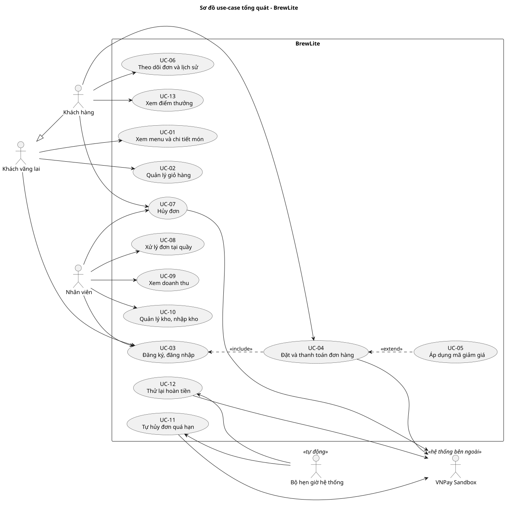

# Đặc tả yêu cầu phần mềm (SRS rút gọn) – BrewLite

Tài liệu của Task 1.2. Bối cảnh, stakeholder và phạm vi xem ở [context-and-scope.md](context-and-scope.md). Đặc tả chi tiết use-case trọng tâm xem ở [uc-04-dat-va-thanh-toan.md](uc-04-dat-va-thanh-toan.md).

## 1. Giới thiệu

### 1.1 Mục đích

Tài liệu xác định BrewLite **phải làm gì** (yêu cầu chức năng) và **phải đạt chất lượng nào** (yêu cầu phi chức năng) trong phiên bản bàn giao. Mỗi yêu cầu có mã định danh, mức ưu tiên MoSCoW và tiêu chí chấp nhận kiểm tra được, để nhóm dùng khi thiết kế, lập trình, viết test và lập ma trận truy vết ở các task sau.

### 1.2 Mức ưu tiên MoSCoW

| Mức | Ý nghĩa với BrewLite |
| --- | --- |
| **Must** | Bắt buộc có trong bản bàn giao; thiếu thì luồng xem menu → đặt đơn → thanh toán → theo dõi đơn không chạy được, hoặc không đạt yêu cầu bắt buộc của đề |
| **Should** | Quan trọng, làm trong Sprint 2; thiếu thì hệ thống vẫn dùng được nhưng kém đầy đủ |
| **Could** | Chỉ làm khi đã xong Must và Should |
| **Won't** | Không làm trong phiên bản này, ghi lại cho phiên bản sau |

Mức ưu tiên của từng yêu cầu ghi ở cột "Ưu tiên" trong các bảng ở mục 3 và 4.

### 1.3 Thuật ngữ

| Thuật ngữ | Giải thích |
| --- | --- |
| Khách vãng lai | Người dùng chưa đăng nhập |
| Khách hàng | Người dùng đã đăng nhập với vai trò `CUSTOMER` |
| Nhân viên | Người dùng đã đăng nhập với vai trò `STAFF`, làm việc tại quầy |
| JWT | Chuỗi xác thực server cấp sau khi đăng nhập; web gửi kèm mỗi yêu cầu trong header `Authorization: Bearer <token>` |
| Idempotency-Key | Khóa do web tạo cho mỗi lần bấm thanh toán; gửi lại cùng khóa thì server trả lại giao dịch cũ, không tạo giao dịch mới |
| VNPay Sandbox | Môi trường thử của cổng thanh toán VNPay, dùng thẻ thử, không trừ tiền thật. Đây là dịch vụ thanh toán mô phỏng (Payment Service) của hệ thống |
| Ví / Thẻ | Hai phương thức thanh toán không dùng tiền mặt khách chọn ở Checkout: Ví (khách chọn cách trả trên trang VNPay) và Thẻ (thẻ ngân hàng nội địa) |
| Return URL | Trang VNPay chuyển khách về sau khi thanh toán, kèm kết quả có chữ ký |
| IPN | Yêu cầu VNPay gửi thẳng tới API để báo kết quả giao dịch, kèm chữ ký |
| Truy vấn giao dịch | Việc API hỏi lại VNPay kết quả thật của một giao dịch trước khi cập nhật đơn |
| Nguyên liệu | Thứ cửa hàng trữ trong kho (sữa, trà, cà phê…); tồn kho được tính theo nguyên liệu, không theo món |
| Công thức | Lượng từng nguyên liệu cần để pha một ly (tính cho size M) hoặc cho một phần topping |
| Số ly còn pha được | Số ly tối đa của một món còn pha được từ lượng nguyên liệu đang có |
| Đơn chờ | Đơn đã tạo nhưng chưa thanh toán thành công (`PENDING` hoặc `PAYMENT_FAILED`) |
| Transaction | Nhóm thao tác ghi CSDL hoặc cùng thành công, hoặc cùng bị hủy |
| Optimistic locking | Cách chống ghi đè khi nhiều yêu cầu cùng sửa một dòng dữ liệu: mỗi dòng có số phiên bản, ghi thất bại nếu phiên bản đã đổi thì thử lại |

### 1.4 Quy tắc nghiệp vụ

| Mã | Quy tắc |
| --- | --- |
| BR-01 | **Giá.** Đơn giá một ly = giá món + phụ thu size (S: 0đ, M: 5.000đ, L: 10.000đ) + tổng giá topping đã chọn. Thành tiền một dòng = đơn giá × số lượng. Tổng đơn = tổng thành tiền các dòng − số tiền giảm. |
| BR-02 | **Tính giá ở server.** Server luôn tính lại giá từ CSDL; web không gửi giá lên. Dữ liệu gửi lên có trường không được khai báo thì bị từ chối. |
| BR-03 | **Tồn kho theo nguyên liệu.** Lượng nguyên liệu cho một ly = công thức size M × hệ số size (S: 0,8; M: 1; L: 1,3), làm tròn lên; lượng của topping không đổi theo size. Số ly còn pha được = giá trị nhỏ nhất của (tồn kho ÷ lượng cần) trên các nguyên liệu của món. Món hiển thị "Hết món" khi không pha nổi 1 ly size S không topping. |
| BR-04 | **Trừ và trả kho.** Nguyên liệu bị trừ ngay khi tạo đơn, trong cùng transaction với việc tạo đơn, có optimistic locking. Không đủ nguyên liệu thì không tạo đơn, không trừ nguyên liệu nào. Đơn bị hủy thì trả lại đúng lượng đã trừ. |
| BR-05 | **Hạn thanh toán.** Đơn phải thanh toán thành công trong 5 phút kể từ khi tạo; thanh toán lại không được cộng thêm thời gian. Quá hạn thì hệ thống hỏi lại VNPay, chưa có tiền thì tự hủy đơn và trả kho. |
| BR-06 | **Một đơn chờ.** Mỗi khách giữ tối đa một đơn chờ. Đặt đơn mới thì đơn chờ cũ bị hủy và trả kho; nếu đơn mới không đủ nguyên liệu thì báo lỗi và giữ nguyên đơn cũ. |
| BR-07 | **Mã giảm giá.** Mã hợp lệ khi tồn tại, đang hoạt động, còn hạn và tạm tính đạt mức tối thiểu của mã. Có hai loại: giảm theo phần trăm tạm tính và giảm một số tiền cố định. Web kiểm tra trước, server kiểm tra lại khi tạo đơn. |
| BR-08 | **Điểm thưởng.** Số điểm = phần nguyên của (tổng đơn ÷ 10.000). Điểm được cộng một lần duy nhất khi đơn chuyển sang `PAID`. Hủy đơn đã `PAID` thì trừ lại đúng số điểm đã cộng, số dư không âm. Phiên bản này chỉ tích điểm, chưa đổi điểm. |
| BR-09 | **Vòng đời đơn.** `PENDING → PAID → PREPARING → READY → COMPLETED`; `PENDING → PAYMENT_FAILED → PENDING` (thanh toán lại); hủy (`CANCELLED`) được từ `PENDING`, `PAYMENT_FAILED`, `PAID`. `COMPLETED` và `CANCELLED` là trạng thái kết thúc. Mọi chuyển tiếp khác bị chặn. |
| BR-10 | **Quyền đổi trạng thái.** `PAID` và `PAYMENT_FAILED` chỉ được đặt khi server đã xác minh kết quả thanh toán. Nhân viên chuyển `PAID → PREPARING → READY → COMPLETED` và chỉ hủy được đơn `PAID`. Khách hủy được đơn của mình ở `PENDING`, `PAYMENT_FAILED`, `PAID`. |
| BR-11 | **Đổi trạng thái đồng thời.** Hai yêu cầu cùng đổi trạng thái một đơn thì chỉ một yêu cầu thành công; yêu cầu còn lại bị từ chối vì trạng thái đã thay đổi. |
| BR-12 | **Thanh toán thành công.** Đơn chỉ thành `PAID` khi kết quả từ VNPay có chữ ký hợp lệ, đúng số tiền và được xác nhận khi truy vấn lại giao dịch. Cùng một kết quả gửi về nhiều lần chỉ cập nhật đơn và cộng điểm một lần. |
| BR-13 | **Hoàn tiền.** Hủy đơn đã `PAID` thì hệ thống gửi yêu cầu hoàn tiền tới VNPay; lỗi thì đơn ở tình trạng "Đang hoàn tiền" và tự thử lại định kỳ. Khách trả tiền cho đơn đã bị hủy thì đơn vẫn giữ hủy và được hoàn tiền. |
| BR-14 | **Doanh thu.** Chỉ tính các giao dịch thanh toán thành công của đơn không bị hủy, không bị hoàn tiền. |

## 2. Mô tả tổng quan

### 2.1 Tác nhân

| Tác nhân | Loại | Mô tả |
| --- | --- | --- |
| Khách vãng lai | Chính | Chưa đăng nhập; xem menu, xem chi tiết món, dùng giỏ hàng, đăng ký và đăng nhập |
| Khách hàng | Chính | Đã đăng nhập; làm được mọi việc của khách vãng lai, thêm đặt đơn, thanh toán, áp mã giảm giá, theo dõi và hủy đơn của mình |
| Nhân viên | Chính | Đã đăng nhập vai trò `STAFF`; xử lý đơn tại quầy, hủy đơn đã thanh toán, xem doanh thu, xem kho và nhập kho. Quản lý cửa hàng dùng tài khoản này để theo dõi doanh thu và tồn kho |
| VNPay Sandbox | Phụ (hệ thống bên ngoài) | Nhận yêu cầu thanh toán và hoàn tiền, trả kết quả có chữ ký, trả lời khi hệ thống truy vấn giao dịch |
| Bộ hẹn giờ hệ thống | Phụ (tự động) | Định kỳ tự hủy đơn quá hạn thanh toán và thử lại các lần hoàn tiền bị lỗi |

Quản lý cửa hàng là stakeholder (xem [context-and-scope.md](context-and-scope.md)), không phải tác nhân riêng: khi dùng hệ thống, quản lý đóng vai Nhân viên.

### 2.2 Môi trường vận hành

- Người dùng truy cập bằng trình duyệt trên điện thoại hoặc máy tính; web cài được dưới dạng PWA.
- Frontend Next.js gọi REST API (JSON) của backend NestJS; dữ liệu lưu trong PostgreSQL, thay đổi cấu trúc bằng migration.
- Thanh toán qua VNPay Sandbox.
- Ba môi trường: **local** (Docker Compose chạy web, API, database), **CI** (GitHub Actions), **production** (web trên Vercel; API chạy từ Docker image lưu trên GitHub Container Registry, triển khai trên Render; PostgreSQL trên Render). Chi tiết ở tài liệu kiến trúc.

## 3. Yêu cầu chức năng

### 3.1 Menu

Người phụ trách: Búp · Mã: FR-01 – FR-02

| Mã | Yêu cầu | Ưu tiên | Tiêu chí chấp nhận |
| --- | --- | --- | --- |
| FR-01 | Khách vãng lai và Khách hàng xem được menu đồ uống và lọc theo danh mục | Must | 1. `GET /products` không cần đăng nhập, trả 200 kèm danh sách món; mỗi món có tên, ảnh, giá, danh mục. 2. Chọn một danh mục thì chỉ hiển thị các món thuộc danh mục đó; chọn "Tất cả" hiển thị lại toàn bộ. 3. Khi đang tải hiển thị trạng thái loading; khi chưa có món nào hiển thị "Chưa có món nào"; khi lỗi kết nối hiển thị thông báo tiếng Việt kèm nút "Thử lại". |
| FR-02 | Hệ thống hiển thị "Hết món" cho món không còn pha được | Must | 1. Món không pha nổi 1 ly size S không topping (đúng BR-03) hiển thị nhãn "Hết món" trên menu. 2. Món đang "Hết món" không thêm được vào giỏ hàng: nút thêm bị vô hiệu. 3. Sau khi nhập kho đủ nguyên liệu, lần tải menu kế tiếp không còn nhãn "Hết món". |

### 3.2 Chi tiết sản phẩm

Người phụ trách: Búp · Mã: FR-03

| Mã | Yêu cầu | Ưu tiên | Tiêu chí chấp nhận |
| --- | --- | --- | --- |
| FR-03 | Khách vãng lai và Khách hàng xem chi tiết món và chọn size, topping, số lượng | Must | 1. `GET /products/:id` không cần đăng nhập, trả 200 kèm tên, mô tả, ảnh, giá, các size S/M/L, các topping và số ly còn pha được; id không tồn tại trả 404, giao diện hiển thị "Không tìm thấy món" kèm liên kết về menu. 2. Chọn một size, chọn được nhiều topping, chọn số lượng. 3. Mỗi lần đổi size, topping hoặc số lượng, giá hiển thị cập nhật ngay, đúng BR-01; giá lấy từ dữ liệu server, web không tự đặt giá (BR-02). 4. Trang hiển thị "Còn X ly" tính theo BR-03; khi X bằng 0 hiển thị "Hết món" và không thêm được vào giỏ. |

### 3.3 Giỏ hàng

Người phụ trách: Linh · Mã: FR-04 – FR-07 (gồm giỏ hàng, Checkout, mã giảm giá)

| Mã | Yêu cầu | Ưu tiên | Tiêu chí chấp nhận |
| --- | --- | --- | --- |
| FR-04 | Khách hàng quản lý giỏ hàng và xem tạm tính | Must | 1. Khách thêm món (kèm size, topping, số lượng) vào giỏ từ trang chi tiết sản phẩm. 2. Cùng món, cùng size, cùng bộ topping thì gộp thành một dòng và cộng dồn số lượng; khác size hoặc khác topping thì là dòng riêng. 3. Khách tăng hoặc giảm số lượng từng dòng, số lượng tối thiểu là 1; muốn bỏ món thì xóa dòng; có nút xóa toàn bộ giỏ. 4. Thành tiền mỗi dòng bằng đơn giá nhân số lượng; tạm tính bằng tổng các thành tiền, đơn giá tính đúng BR-01. 5. Số lượng món trên thanh điều hướng cập nhật ngay khi giỏ thay đổi. 6. Tải lại trang thì giỏ vẫn còn. 7. Giỏ trống hiện thông báo "Giỏ hàng đang trống" và nút về Menu. 8. Giỏ bị xóa khi thanh toán thành công và khi đăng xuất; giỏ được giữ nguyên khi thanh toán không thành công hoặc khi khách hủy ở trang thanh toán. |
| FR-05 | Giỏ hàng cảnh báo khi vượt số ly còn pha được | Should | 1. Với mỗi dòng trong giỏ, giao diện gọi `POST /products/availability` kèm các dòng khác trong giỏ và dòng đang xét (productId, size, toppingIds); server trả `maxQuantity` là số ly tối đa dòng đó được có, tính theo BR-03. 2. Giao diện gọi lại mỗi khi giỏ thay đổi. 3. Dòng có số lượng lớn hơn `maxQuantity` được tô đỏ kèm dòng chữ "Chỉ còn pha được X ly"; nút "+" bị khóa khi số lượng đã bằng `maxQuantity`. 4. Khi có ít nhất một dòng vượt, hiện khung cảnh báo ở phần tổng tiền và khóa nút "Tiến hành thanh toán". 5. Nguyên liệu dùng chung giữa các món (kể cả topping) do server tính; giao diện chỉ hiển thị kết quả. |
| FR-06 | Khách hàng xem lại đơn ở Checkout và chọn phương thức thanh toán | Must | 1. Checkout hiện danh sách món (tên, size, topping, số lượng, thành tiền), tạm tính, giảm giá và tổng cộng; giá hiển thị chỉ để tham khảo, server tính lại khi tạo đơn (BR-02). 2. Khách chọn một trong hai phương thức: Ví hoặc Thẻ. 3. Chưa đăng nhập thì chuyển sang trang đăng nhập; đăng nhập xong quay lại Checkout. 4. Giỏ trống thì không vào được Checkout (chuyển về trang giỏ hàng). 5. Khi khách bấm Thanh toán, Checkout gửi đơn (kèm phương thức và mã giảm giá nếu có) để tạo đơn rồi chuyển sang thanh toán VNPay Sandbox; việc tạo đơn thuộc mục 3.5, thanh toán thuộc mục 3.6. 6. Nếu tạo đơn thất bại (ví dụ thiếu nguyên liệu, BR-04), hiện thông báo lỗi tiếng Việt, ở lại trang và giữ nguyên giỏ. 7. Trong lúc xử lý, nút Thanh toán bị khóa để tránh bấm nhiều lần. 8. Nếu khách đang có đơn chờ thanh toán còn hạn (BR-05), Checkout hiện nhắc kèm đường dẫn tới đơn đó và cho biết đặt đơn mới sẽ hủy đơn cũ (BR-06). |
| FR-07 | Khách hàng áp dụng mã giảm giá ở Checkout | Should | 1. Khách nhập mã và bấm Áp dụng; giao diện gọi `POST /promotions/validate` kèm mã và tạm tính. 2. Mã hợp lệ (giảm theo phần trăm hoặc giảm số tiền cố định) thì hiện số tiền giảm và tổng sau giảm. 3. Mã không tồn tại, hết hạn, ngừng hoạt động hoặc đơn chưa đạt mức tối thiểu thì server trả lỗi và giao diện hiện đúng lý do bằng tiếng Việt; tổng tiền không đổi. 4. Khi tạo đơn, server kiểm tra lại mã và tính lại số tiền giảm; số tiền cuối cùng do server quyết định (BR-02, BR-07). |

### 3.4 Xác thực

Người phụ trách: Khoa · Mã: FR-08 – FR-09

| Mã | Yêu cầu | Ưu tiên | Tiêu chí chấp nhận |
| --- | --- | --- | --- |
| FR-08 | Khách vãng lai đăng ký tài khoản Khách hàng | Must | 1. `POST /auth/register` không cần đăng nhập, nhận họ tên, email và mật khẩu. 2. Họ tên để trống, email sai định dạng hoặc mật khẩu dưới 6 ký tự thì trả 400 kèm thông báo tiếng Việt ("Vui lòng nhập họ tên", "Email không hợp lệ", "Mật khẩu tối thiểu 6 ký tự"); gửi kèm trường không được khai báo cũng trả 400 (BR-02). 3. Email đã được đăng ký (không phân biệt chữ hoa, chữ thường) thì trả 409 "Email đã được đăng ký". 4. Thành công trả 201 kèm JWT và thông tin tài khoản (mã, họ tên, email, vai trò, điểm thưởng), không có mật khẩu; tài khoản mới luôn có vai trò `CUSTOMER`. 5. Mật khẩu được lưu dạng băm, không lưu bản gốc. 6. Màn hình đăng ký kiểm tra dữ liệu trước khi gửi và hiện lỗi bằng tiếng Việt; đăng ký thành công thì được đăng nhập luôn và chuyển về trang chủ. |
| FR-09 | Người dùng đăng nhập, giữ phiên, đăng xuất và được phân quyền theo vai trò | Must | 1. `POST /auth/login` đúng email và mật khẩu thì trả 200 kèm JWT và thông tin tài khoản; sai email hoặc sai mật khẩu đều trả 401 với cùng thông báo "Email hoặc mật khẩu không đúng". 2. JWT có thời hạn 1 ngày; web gửi kèm header `Authorization: Bearer <token>` ở các yêu cầu cần đăng nhập. 3. API cần đăng nhập mà thiếu token thì trả 401 "Vui lòng đăng nhập"; token sai hoặc hết hạn thì trả 401 "Phiên đăng nhập đã hết hạn". 4. `GET /auth/me` trả thông tin người đang đăng nhập, không có mật khẩu. 5. Khi API trả 401, web tự đăng xuất và chuyển tới trang đăng nhập; đăng nhập xong quay lại đúng trang đang xem. 6. Tài khoản Khách hàng gọi API của Nhân viên thì trả 403 "Chỉ nhân viên được truy cập" (BR-10). 7. Bấm Đăng xuất thì web xóa token và giỏ hàng. |

### 3.5 Đặt đơn

Người phụ trách: Quang · Mã: FR-10 – FR-13 (gồm tạo đơn, tồn kho, một đơn chờ, tự hủy đơn quá hạn)

| Mã | Yêu cầu | Ưu tiên | Tiêu chí chấp nhận |
| --- | --- | --- | --- |
| FR-10 | Khách hàng tạo đơn hàng từ giỏ | Must | 1. `POST /orders` cần JWT; nhận `paymentMethod`, danh sách món (`productId`, `size`, `toppingIds`, `quantity`) và mã giảm giá nếu có; thiếu hoặc sai JWT trả 401. 2. Dữ liệu sai trả 400; món hoặc topping không tồn tại trả 400. 3. Giá do server tính lại theo BR-01, BR-02; web không gửi giá. 4. Đơn mới ở trạng thái `PENDING`, có mã đơn dạng `BL-XXXXXX` và hạn thanh toán theo BR-05. |
| FR-11 | Hệ thống trừ nguyên liệu khi tạo đơn và trả lại khi hủy | Must | 1. Nguyên liệu bị trừ trong cùng transaction với việc tạo đơn, có optimistic locking theo BR-03, BR-04. 2. Không đủ nguyên liệu thì trả 400 "Món … không đủ nguyên liệu, chỉ còn pha được N ly", không tạo đơn, không trừ nguyên liệu nào. 3. Nhiều đơn tranh nhau mà thử lại nhiều lần vẫn không ghi được thì trả 409 "Hệ thống đang bận, vui lòng đặt lại sau giây lát". 4. Đơn bị hủy thì trả lại đúng lượng nguyên liệu đã trừ. |
| FR-12 | Mỗi khách chỉ giữ một đơn chờ | Should | 1. Khách đặt đơn mới khi đang có đơn chờ thì đơn chờ cũ bị hủy và trả kho theo BR-06. 2. Đơn mới không đủ nguyên liệu thì trả 400 và giữ nguyên đơn chờ cũ. |
| FR-13 | Hệ thống tự hủy đơn quá hạn thanh toán | Must | 1. Cứ 30 giây hệ thống kiểm tra các đơn chờ một lần. 2. Đơn quá 5 phút chưa thanh toán thành công thì hệ thống hỏi lại VNPay; chưa có tiền thì tự hủy đơn và trả kho theo BR-05. |

### 3.6 Thanh toán

Người phụ trách: Triệu · Mã: FR-14 – FR-18 (gồm VNPay Sandbox, idempotency, thanh toán thất bại, hoàn tiền, điểm thưởng)

| Mã | Yêu cầu | Ưu tiên | Tiêu chí chấp nhận |
| --- | --- | --- | --- |
| FR-14 | Khách hàng thanh toán bằng Ví hoặc Thẻ qua VNPay Sandbox | Must | 1. `POST /payments` cần JWT, nhận `orderId` và `method`; thiếu hoặc sai JWT trả 401, dữ liệu không hợp lệ trả 400, đơn không tồn tại hoặc không thuộc khách trả 404. 2. Chỉ nhận đơn ở `PENDING` hoặc `PAYMENT_FAILED` và còn hạn theo BR-05; trạng thái không phù hợp trả 400, quá hạn trả 400 "Đơn đã hết thời gian thanh toán". 3. API trả mã giao dịch và đường dẫn thanh toán VNPay. Chọn Ví thì không gửi mã ngân hàng; chọn Thẻ thì dùng thẻ ngân hàng nội địa. Web hiện trạng thái đang xử lý trong lúc chờ và chuyển khách sang VNPay khi nhận được đường dẫn. 4. Kết quả qua Return URL hoặc IPN phải được server kiểm tra chữ ký, đối chiếu đúng đơn, giao dịch và số tiền, rồi truy vấn lại VNPay trước khi ghi nhận thành công theo BR-12. Kết quả sai chữ ký bị từ chối với lỗi 400 "Chữ ký VNPay không hợp lệ"; sai số tiền bị từ chối với lỗi 400 "Số tiền VNPay không khớp với đơn hàng"; đơn không chuyển sang `PAID`. 5. Chỉ khi server xác nhận thành công, web mới xóa giỏ hàng và hiện xác nhận đơn theo FR-19. |
| FR-15 | Hệ thống không tạo thanh toán trùng khi nhận lại cùng yêu cầu | Must | 1. `POST /payments` phải có header `Idempotency-Key`; thiếu hoặc để trống trả 400 "Thiếu header Idempotency-Key". 2. Với cùng khách hàng, cùng khóa, cùng đơn và phương thức, server trả lại giao dịch đã tạo, không tạo giao dịch mới; hai yêu cầu cùng khóa đến đồng thời cũng chỉ tạo một giao dịch. 3. Cùng khách hàng dùng lại khóa cho đơn hoặc phương thức khác thì trả 409 "Idempotency-Key đã được dùng cho một thanh toán khác". Mỗi yêu cầu vẫn phải được kiểm tra xác thực và quyền sở hữu đơn. 4. Return URL và IPN có thể đến nhiều lần hoặc theo thứ tự khác nhau; hệ thống chỉ ghi nhận thanh toán và cộng điểm một lần theo BR-12. Kết quả cũ không được làm đơn đã thanh toán quay lại `PAYMENT_FAILED`. |
| FR-16 | Khách hàng biết lý do thanh toán thất bại và có thể thanh toán lại | Must | 1. Khi server xác minh giao dịch thất bại, đơn đang chờ chuyển sang `PAYMENT_FAILED` theo BR-09, BR-10; web báo lý do bằng tiếng Việt và giữ nguyên giỏ hàng. 2. Đơn còn hạn có nút "Thanh toán lại". Web gọi `POST /payments` cho chính đơn đó với `Idempotency-Key` mới; khi tạo được giao dịch mới, đơn trở về `PENDING`, không tạo lại đơn hay trừ kho thêm. 3. Thanh toán lại không kéo dài hạn theo BR-05; quá hạn trả 400 "Đơn đã hết thời gian thanh toán" và không tạo giao dịch mới. 4. Khách không quay về Return URL thì server vẫn nhận IPN và chủ động truy vấn VNPay để cập nhật đơn. Nếu chưa xác minh được kết quả, web hiện "Đang kiểm tra thanh toán"; không tự kết luận thất bại hoặc cho tạo thêm giao dịch khi giao dịch trước chưa rõ kết quả. |
| FR-17 | Khách hàng hủy đơn và được hoàn tiền nếu đơn đã thanh toán | Should | 1. `PATCH /orders/:id/cancel` cần JWT; thiếu hoặc sai JWT trả 401, đơn không tồn tại hoặc không thuộc khách trả 404. Khách chỉ hủy được đơn của mình ở `PENDING`, `PAYMENT_FAILED`, `PAID`; trạng thái khác trả 400 theo BR-10. 2. Hủy thành công trả mã đơn và trạng thái `CANCELLED`, trả lại đúng nguyên liệu theo BR-04. Với đơn đã `PAID`, hệ thống trừ lại điểm theo BR-08 và gửi yêu cầu hoàn tiền theo BR-13. 3. Nếu hoàn tiền chưa thành công, đơn vẫn là `CANCELLED`, web hiện "Đang hoàn tiền"; hệ thống tự thử lại mỗi 60 giây. Khi VNPay xác nhận hoàn tiền thành công, web hiện "Đã hoàn tiền". 4. Nếu tiền về sau khi đơn đã bị hủy, hệ thống giữ `CANCELLED` và xử lý hoàn tiền theo BR-13. Kết quả gửi lại không được làm trả kho, trừ điểm hoặc hoàn tiền trùng. 5. Hai yêu cầu cùng đổi trạng thái thì chỉ một yêu cầu thành công; yêu cầu còn lại trả 409 "Đơn đã thay đổi trạng thái, vui lòng tải lại" theo BR-11. |
| FR-18 | Khách hàng tích điểm sau khi thanh toán và xem số điểm hiện có | Should | 1. Khi đơn chuyển sang `PAID`, hệ thống tính và cộng điểm đúng một lần theo BR-08; không cộng điểm cho đơn chưa xác minh thanh toán thành công. 2. Hủy đơn đã `PAID` thì trừ lại đúng số điểm đã cộng của đơn đó; số dư không âm theo BR-08. Yêu cầu hoặc kết quả gửi lại không làm cộng, trừ điểm thêm lần nữa. 3. Khách đã đăng nhập thấy số điểm hiện có trên thanh điều hướng; số điểm được cập nhật từ server sau thanh toán thành công, sau hủy đơn và khi tải lại trang. Nếu tải điểm lỗi, web báo "Không tải được điểm thưởng", không hiển thị số 0 thay cho lỗi. 4. Phiên bản này chỉ tích và xem điểm, không có chức năng đổi điểm theo BR-08. |

### 3.7 Lịch sử đơn

Người phụ trách: Khoa · Mã: FR-19 – FR-20 (gồm xác nhận đơn, lịch sử và chi tiết đơn)

| Mã | Yêu cầu | Ưu tiên | Tiêu chí chấp nhận |
| --- | --- | --- | --- |
| FR-19 | Khách hàng xem xác nhận đơn sau khi thanh toán | Must | 1. Sau khi VNPay chuyển khách về trang kết quả, web gửi kết quả về server để xác minh (BR-12), không tự tin vào kết quả trên đường dẫn. 2. Thanh toán thành công: hiện thông báo thành công kèm mã đơn dạng `BL-XXXXXX`; xóa giỏ hàng; cập nhật số điểm thưởng trên thanh điều hướng; sau 3 giây tự chuyển sang trang chi tiết đơn. 3. Thanh toán không thành công: hiện lý do bằng tiếng Việt theo mã kết quả VNPay trả về, giữ nguyên giỏ hàng và có nút mở đơn để thanh toán lại. 4. Trang chi tiết đơn là trang xác nhận đầy đủ: mã đơn, trạng thái, danh sách món, giảm giá, tổng tiền. |
| FR-20 | Khách hàng xem lịch sử và chi tiết đơn của mình | Must | 1. `GET /orders/me` cần đăng nhập, chỉ trả đơn của chính người dùng, đơn mới nhất trước; mỗi đơn có mã, thời gian đặt, trạng thái, phương thức thanh toán, tổng tiền và danh sách món. 2. `GET /orders/:id` trả chi tiết đơn của chính người dùng; mã đơn không phải số thì trả 400; đơn không tồn tại hoặc của người khác đều trả 404 "Không tìm thấy đơn hàng". 3. Trang Lịch sử hiện danh sách đơn kèm nhãn trạng thái bằng tiếng Việt; chưa có đơn thì hiện thông báo trống và nút về Menu; bấm vào một đơn thì mở trang chi tiết. 4. Trang chi tiết hiện mã đơn, trạng thái, từng món (size, topping, số lượng, thành tiền), giảm giá, tổng tiền; đơn đã hủy có nhãn tình trạng hoàn tiền nếu có. 5. Đơn đang chờ thanh toán hiện đồng hồ đếm ngược tới hạn thanh toán (BR-05) cùng nút thanh toán tiếp và nút hủy đơn (xử lý ở mục 3.6); hết giờ thì trang tự tải lại để cập nhật trạng thái. |

### 3.8 Quản lý trạng thái đơn

Người phụ trách: Quang · Mã: FR-21 – FR-24 (gồm vòng đời trạng thái, nhân viên đổi trạng thái, doanh thu, kho và nhập kho)

| Mã | Yêu cầu | Ưu tiên | Tiêu chí chấp nhận |
| --- | --- | --- | --- |
| FR-21 | Vòng đời trạng thái đơn | Must | Chỉ cho các chuyển tiếp theo BR-09; chuyển sai (ví dụ hủy đơn đang `PREPARING`) trả 400; hai yêu cầu đổi trạng thái cùng lúc thì chỉ một thành công, yêu cầu còn lại trả 409 (BR-11) |
| FR-22 | Nhân viên xử lý đơn tại quầy | Must | `GET /staff/orders?status=` và `PATCH /staff/orders/:id/status` chỉ cho vai trò Nhân viên, khách gọi trả 403 "Chỉ nhân viên được truy cập" (BR-10); trạng thái gửi lên không hợp lệ hoặc nhân viên không được chuyển sang trạng thái đó thì trả 400; đơn vừa bị đổi trạng thái bởi yêu cầu khác thì trả 409 "Đơn vừa đổi trạng thái, vui lòng tải lại"; màn hình quầy lọc đơn theo trạng thái, nút Nhận đơn → Pha xong → Giao khách; nhân viên hủy được đơn `PAID` |
| FR-23 | Xem doanh thu | Should | `GET /staff/revenue` chỉ cho Nhân viên; chỉ tính giao dịch thành công của đơn không hủy, không hoàn tiền (BR-14) |
| FR-24 | Xem kho và nhập kho | Should | `GET /staff/ingredients` hiện tồn kho từng nguyên liệu, đánh dấu nguyên liệu sắp hết; `POST /staff/ingredients/:id/restock` cộng thêm số lượng, số lượng không hợp lệ trả 400 |

### 3.9 Yêu cầu ngoài phạm vi

Người phụ trách: Hùng · Mã: FR-25 trở đi

| Mã | Yêu cầu | Ưu tiên | Ghi chú |
| --- | --- | --- | --- |
| FR-25 | Thêm, sửa món và giá | Won't | Là việc của quản lý, cần vai trò Quản lý riêng (FR-27); menu được nạp bằng dữ liệu seed |
| FR-26 | Quản lý mã giảm giá | Won't | Là việc của quản lý, cần vai trò Quản lý riêng (FR-27); mã giảm giá được nạp bằng dữ liệu seed |
| FR-27 | Vai trò Quản lý cửa hàng riêng | Won't | Quản lý dùng tài khoản Nhân viên để xem doanh thu và kho |
| FR-28 | Đổi điểm thưởng lấy ưu đãi | Won't | Phiên bản này chỉ tích điểm (BR-08) |
| FR-29 | Giao hàng tận nơi | Won't | Khách nhận đồ uống tại quầy |
| FR-30 | Thông báo đẩy khi đơn đổi trạng thái | Won't | Khách xem trạng thái ở trang đơn hàng |
| FR-31 | Nhiều chi nhánh | Won't | Hệ thống phục vụ một cửa hàng |
| FR-32 | Thanh toán bằng tiền thật | Won't | Chỉ dùng VNPay Sandbox |

## 4. Yêu cầu phi chức năng

Người phụ trách: Búp · Mã: NFR-01 trở đi, đánh số liên tục qua các mục 4.1 – 4.4

### 4.1 Hiệu năng

| Mã | Yêu cầu | Ưu tiên | Tiêu chí chấp nhận |
| --- | --- | --- | --- |
| NFR-01 | API phản hồi nhanh khi server đang chạy | Should | 1. Đo `GET /products` và `GET /products/:id` trên database có dữ liệu seed, khi server đã khởi động xong: ít nhất 95% yêu cầu phản hồi dưới 500 ms. 2. Không tính lần khởi động lại của gói miễn phí. |
| NFR-02 | Đặt đơn đồng thời không bán vượt kho | Must | 1. Gửi 20 yêu cầu đặt đơn cùng lúc cho món mà nguyên liệu chỉ đủ cho 3 ly: đúng 3 đơn được tạo; 17 yêu cầu còn lại bị từ chối với mã 400 (không đủ nguyên liệu) hoặc 409 (hệ thống bận, đặt lại sau), không yêu cầu nào tạo được đơn vượt kho. 2. Sau thử nghiệm, tồn kho mọi nguyên liệu không âm và bằng tồn kho ban đầu trừ lượng của các đơn đã tạo (đúng BR-04). |
| NFR-03 | Tự mở rộng thêm server khi đông người dùng | Won't | Không làm trong phiên bản này; hệ thống chạy một bản API. |

### 4.2 Bảo mật

| Mã | Yêu cầu | Ưu tiên | Tiêu chí chấp nhận |
| --- | --- | --- | --- |
| NFR-04 | Mật khẩu lưu dạng băm; JWT có thời hạn | Must | 1. Cột mật khẩu trong database không chứa mật khẩu gốc, và không API nào trả mật khẩu hoặc giá trị băm. 2. Token hết hạn bị từ chối với mã 401. |
| NFR-05 | Phân quyền theo vai trò | Must | 1. Gọi API cần đăng nhập mà thiếu token hoặc token sai trả 401. 2. Khách hàng gọi API dành cho Nhân viên trả 403. |
| NFR-06 | Kiểm tra dữ liệu ở cả web và server | Must | 1. Web hiển thị lỗi tiếng Việt ngay tại ô nhập sai, trước khi gửi lên server. 2. Server từ chối dữ liệu sai kiểu hoặc có trường không được khai báo, trả 400 (đúng BR-02). |
| NFR-07 | Khóa bí mật không nằm trong repo hay log CI | Must | 1. Tìm trong repo không thấy khóa VNPay, mật khẩu database hay khóa ký JWT; các giá trị này nằm trong biến môi trường và secret của CI. 2. Log của pipeline CI không in các giá trị đó. |
| NFR-08 | Production dùng HTTPS; database không public | Must | 1. Truy cập URL production bằng HTTP được chuyển sang HTTPS. 2. Không kết nối trực tiếp tới database production được từ máy ngoài hệ thống. |

### 4.3 Tính khả dụng

| Mã | Yêu cầu | Ưu tiên | Tiêu chí chấp nhận |
| --- | --- | --- | --- |
| NFR-09 | Có health check; URL production truy cập được | Must | 1. `GET /health` trả 200 khi API và database hoạt động bình thường. 2. URL production mở được trang menu khi nghiệm thu. |
| NFR-10 | Mobile-first | Must | 1. Ở màn hình rộng 375 px, các trang menu, chi tiết món, giỏ hàng, thanh toán không cuộn ngang và thao tác được bằng ngón tay. |
| NFR-11 | PWA cài được | Must | 1. Trình duyệt hỗ trợ cho phép cài ứng dụng lên màn hình chính điện thoại. |
| NFR-12 | Trạng thái loading, trống, lỗi bằng tiếng Việt | Must | 1. Mọi trang có dữ liệu đều có trạng thái đang tải, trống và lỗi. 2. Thông báo lỗi bằng tiếng Việt, không hiển thị mã lỗi thô của hệ thống. |
| NFR-13 | Chạy đúng trên các trình duyệt phổ biến | Should | 1. Luồng xem menu đến xác nhận đơn chạy đúng trên bản mới của Chrome, Edge, Firefox và Safari. |
| NFR-14 | PWA xem được menu khi mất mạng | Could | 1. Sau khi đã mở menu một lần, tắt mạng rồi mở lại vẫn xem được menu đã tải, kèm thông báo đang ngoại tuyến. |
| NFR-15 | Ứng dụng di động riêng (Android, iOS) | Won't | Không làm trong phiên bản này; dùng web PWA. |

### 4.4 Khả năng triển khai

| Mã | Yêu cầu | Ưu tiên | Tiêu chí chấp nhận |
| --- | --- | --- | --- |
| NFR-16 | Chạy local bằng một lệnh Docker Compose | Must | 1. Chạy `docker compose up` trên máy sạch dựng được web, API và database. |
| NFR-17 | Migration và seed tái tạo được database | Must | 1. Chạy migration và seed trên database trống tạo đủ cấu trúc và dữ liệu menu. 2. Chạy lại không báo lỗi. |
| NFR-18 | CI chạy trên mọi pull request | Must | 1. Mở pull request thì CI tự chạy lint, test và build. 2. CI lỗi thì không merge được vào nhánh chính. |
| NFR-19 | CD tự động triển khai và có cách rollback | Must | 1. Merge vào nhánh chính thì pipeline CD build image, triển khai và chạy smoke test. 2. Có cách quay lại bản trước khi triển khai lỗi; sau khi quay lại, `GET /health` trả 200. |
| NFR-20 | Ghi log mỗi yêu cầu | Must | 1. Log mỗi yêu cầu có phương thức, đường dẫn, mã trạng thái và thời gian xử lý. 2. Log không chứa mật khẩu hay token. |

## 5. Sơ đồ use-case tổng quát

Người phụ trách: Khoa

Tệp nguồn: [usecase-overview.puml](usecase-overview.puml)

Danh sách use-case và yêu cầu liên quan:

| Mã | Use-case | Tác nhân | Yêu cầu liên quan |
| --- | --- | --- | --- |
| UC-01 | Xem menu và chi tiết món | Khách vãng lai, Khách hàng | FR-01, FR-02, FR-03 |
| UC-02 | Quản lý giỏ hàng | Khách vãng lai, Khách hàng | FR-04, FR-05 |
| UC-03 | Đăng ký, đăng nhập | Khách vãng lai, Nhân viên | FR-08, FR-09 |
| UC-04 | Đặt và thanh toán đơn hàng | Khách hàng; VNPay Sandbox | FR-06, FR-10, FR-11, FR-12, FR-14, FR-15, FR-16, FR-18, FR-19 |
| UC-05 | Áp dụng mã giảm giá | Khách hàng | FR-07 |
| UC-06 | Theo dõi đơn và lịch sử | Khách hàng | FR-20 |
| UC-07 | Hủy đơn | Khách hàng, Nhân viên; VNPay Sandbox | FR-17, FR-21 |
| UC-08 | Xử lý đơn tại quầy | Nhân viên | FR-21, FR-22 |
| UC-09 | Xem doanh thu | Nhân viên | FR-23 |
| UC-10 | Quản lý kho, nhập kho | Nhân viên | FR-24 |
| UC-11 | Tự hủy đơn quá hạn | Bộ hẹn giờ hệ thống; VNPay Sandbox | FR-13 |
| UC-12 | Thử lại hoàn tiền | Bộ hẹn giờ hệ thống; VNPay Sandbox | FR-17 |
| UC-13 | Xem điểm thưởng | Khách hàng | FR-18 |

## 6. Quy ước mã kiểm thử

Các task sau đặt mã test theo bảng dưới và ghi vào ma trận truy vết. Vị trí thư mục chốt lại ở Task 4.

| Tiền tố | Loại kiểm thử | Vị trí dự kiến |
| --- | --- | --- |
| `UT-xx` | Unit test nghiệp vụ backend (tính giá, trạng thái đơn, tồn kho, mã giảm giá, điểm thưởng) | `apps/api/src/` |
| `CT-xx` | Test component giao diện | `apps/web/src/` |
| `API-Txx` | Test API (gọi endpoint, kiểm tra dữ liệu và mã lỗi trả về) | `apps/api/test/` |
| `INT-Txx` | Integration test luồng tạo đơn và thanh toán trên database thật | `tests/integration/` |
| `E2E-Txx` | End-to-end test trên trình duyệt, từ menu đến xác nhận đơn | `tests/e2e/` |
| `SMK-xx` | Smoke test sau khi triển khai production | Pipeline CD |
