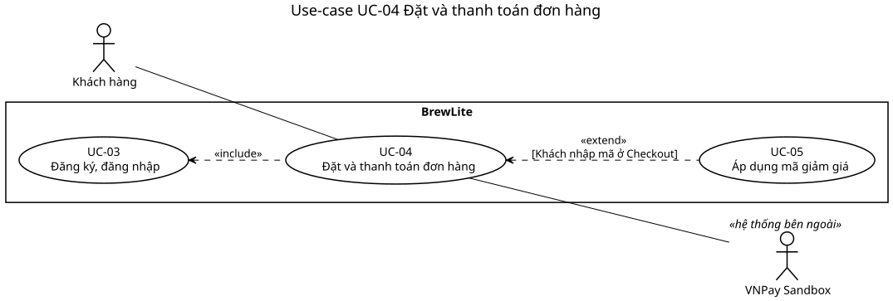

# Đặc tả use-case UC-04 Đặt và thanh toán đơn hàng

## 1. Sơ đồ use-case

Tệp nguồn: [usecase-uc04.puml](usecase-uc04.puml).

UC-04 bao gồm (include) UC-03: khách phải đăng nhập mới đặt được đơn. UC-05 mở rộng (extend) UC-04 khi khách muốn dùng mã giảm giá ở Checkout; khách vẫn đặt và thanh toán được nếu không dùng mã.

## 2. Thông tin chung

| Mục | Nội dung |
| --- | --- |
| Mã, tên | UC-04 Đặt và thanh toán đơn hàng |
| Tác nhân chính | Khách hàng |
| Tác nhân phụ | VNPay Sandbox |
| Mô tả | Khách đặt các món trong giỏ, thanh toán qua VNPay Sandbox và nhận xác nhận đơn. Server tính tiền, kiểm tra kho và xác minh kết quả thanh toán. |
| Trigger | Khách bấm "Đặt hàng" ở Checkout. |
| Tiền điều kiện | Khách có tài khoản `CUSTOMER`; giỏ có ít nhất một món với size, topping và số lượng hợp lệ; khách đã chọn Ví hoặc Thẻ. Khách chưa đăng nhập thì phải đăng nhập theo UC-03 trước khi đặt. Server vẫn phải kiểm tra lại khi nhận yêu cầu. |
| Hậu điều kiện (thành công) | Đơn ở `PAID`; nguyên liệu đã trừ đúng một lần; giao dịch được xác minh theo BR-12; điểm được cộng một lần theo BR-08 khi triển khai phần điểm thưởng; giỏ hàng được xóa và khách thấy xác nhận đơn. |
| Hậu điều kiện (thất bại) | Nếu tạo đơn thất bại thì không có đơn mới, không trừ kho. Nếu thanh toán thất bại đã được xác minh thì đơn ở `PAYMENT_FAILED`, giỏ được giữ lại và nguyên liệu vẫn được giữ cho đơn trong hạn. Đơn quá hạn được xử lý theo BR-05. Khi chưa xác minh được thanh toán, hệ thống báo đang kiểm tra, không báo thành công. |

Các quy tắc BR-xx và yêu cầu FR-xx bên dưới được định nghĩa trong [srs.md](srs.md). Mã giảm giá và điểm thưởng là phần mở rộng mức Should; luồng đặt và thanh toán vẫn chạy được khi chưa triển khai hai phần này.

## 3. Luồng chính

1. Ở Checkout, khách kiểm tra món, size, topping, số lượng và tổng tiền, rồi chọn Ví hoặc Thẻ.
2. Khách bấm "Đặt hàng". Web hiện đang xử lý và gửi `POST /orders` kèm JWT, danh sách món (`productId`, `size`, `toppingIds`, `quantity`) và `paymentMethod`. Web không gửi giá để server dùng làm giá thanh toán.
3. Server kiểm tra JWT, dữ liệu đầu vào và tính lại giá từ CSDL theo BR-01, BR-02. Nếu có mã giảm giá, server kiểm tra lại theo BR-07.
4. Server kiểm tra nguyên liệu và trừ kho trong cùng transaction với việc tạo đơn theo BR-03, BR-04. Đơn được tạo ở `PENDING`; API trả mã đơn, tổng tiền và hạn thanh toán theo BR-05. Nếu khách đã có đơn chờ, xử lý theo A3.
5. Web tạo `Idempotency-Key` cho lần thanh toán này, rồi gửi `POST /payments` kèm JWT, header đó, `orderId` và `method` tương ứng với lựa chọn của khách.
6. Server kiểm tra quyền sở hữu đơn, trạng thái, hạn thanh toán và khóa idempotency theo FR-14, FR-15. Server tạo giao dịch với số tiền của đơn đã lưu, trả mã giao dịch và đường dẫn VNPay. Ví không gửi mã ngân hàng; Thẻ dùng thẻ ngân hàng nội địa.
7. Web chuyển khách sang VNPay Sandbox. Khách thực hiện thanh toán bằng thông tin thử của Sandbox.
8. VNPay chuyển khách về Return URL và gửi IPN tới server. Web chuyển kết quả Return URL về server để xác minh; Return URL và IPN không bắt buộc đến theo thứ tự này.
9. Server kiểm tra chữ ký, đối chiếu đơn, giao dịch, số tiền và truy vấn lại VNPay theo BR-12. Khi xác nhận thành công và đơn còn đủ điều kiện, server chuyển đơn sang `PAID`, ghi nhận giao dịch một lần và cộng điểm theo BR-08 nếu đã triển khai điểm thưởng. Các cập nhật này phải nhất quán, không có trường hợp ghi nhận thành công nhưng bỏ sót điểm.
10. Web nhận trạng thái đã được server xác nhận, xóa giỏ hàng, hiện thông báo thành công và mã đơn theo FR-19; cập nhật điểm trên thanh điều hướng nếu đã triển khai. Khách có thể xem chi tiết đơn để theo dõi các bước tiếp theo.

## 4. Luồng thay thế

### A1. Áp dụng mã giảm giá

1. Trước bước 2, khách nhập mã và bấm "Áp dụng". Web gọi `POST /promotions/validate` theo FR-07.
2. Mã hợp lệ thì web hiện số tiền giảm và tổng sau giảm. Mã không hợp lệ thì hiện lý do bằng tiếng Việt, không thay đổi tổng tiền; khách có thể sửa mã hoặc tiếp tục không dùng mã.
3. Khi đặt hàng, web gửi kèm mã. Server kiểm tra lại ở bước 3 theo BR-07; nếu mã không còn hợp lệ, trả 400 và báo lý do để khách kiểm tra lại Checkout, không tạo đơn hay trừ kho.

### A2. Thanh toán lại sau khi thất bại

1. Với đơn `PAYMENT_FAILED` còn hạn, khách mở đơn và bấm "Thanh toán lại".
2. Web gửi `POST /payments` cho chính đơn đó với `Idempotency-Key` mới. Gửi lại do lỗi mạng của cùng yêu cầu thì vẫn giữ khóa cũ như E4.
3. Khi tạo được giao dịch mới, server chuyển đơn về `PENDING`; không tạo lại đơn, không trừ kho thêm và không gia hạn thanh toán theo BR-05, BR-09.
4. Tiếp tục từ bước 7 của luồng chính. Nếu đơn đã quá hạn, chuyển sang E5.

### A3. Khách đã có một đơn chờ

1. Ở bước 4, server xử lý đơn chờ cũ theo BR-06 khi tạo đơn mới.
2. Nếu tạo được đơn mới, hủy đơn chờ cũ và trả lại nguyên liệu đã giữ cho đơn cũ. Các thay đổi phải cùng thành công trong transaction.
3. Nếu không đủ nguyên liệu cho đơn mới, giữ nguyên đơn cũ và kho, trả lỗi như E1.
4. Nếu tiền về cho đơn cũ sau khi đã hủy, giữ đơn cũ ở `CANCELLED` và hoàn tiền theo BR-13, FR-17.

## 5. Luồng ngoại lệ

### E1. Không đủ nguyên liệu hoặc dữ liệu đặt hàng không hợp lệ

- Ở bước 3 hoặc 4, dữ liệu sai trả 400 và web hiện lý do để khách sửa.
- Không đủ nguyên liệu trả 400, báo món bị thiếu và số ly còn pha được theo FR-11. Không tạo đơn mới, không trừ nguyên liệu nào và giữ giỏ để khách sửa.
- Nếu nhiều đơn tranh kho và server không thể ghi sau các lần thử lại, trả 409 "Hệ thống đang bận, vui lòng đặt lại sau giây lát" theo FR-11.

### E2. Chưa đăng nhập hoặc phiên đăng nhập hết hạn

- `POST /orders` hoặc `POST /payments` thiếu JWT hay JWT không hợp lệ trả 401. Web yêu cầu đăng nhập lại và giữ giỏ hàng.
- Nếu đơn đã được tạo trước khi phiên hết hạn, sau khi đăng nhập khách tiếp tục với đơn còn hạn đó; không tự tạo thêm đơn.
- Khi gọi thanh toán cho đơn không tồn tại hoặc không thuộc khách, trả 404 và không tạo giao dịch.

### E3. Thanh toán thất bại hoặc chưa rõ kết quả

- Sau khi server xác minh VNPay báo thất bại, đơn đang chờ chuyển sang `PAYMENT_FAILED`. Web hiện lý do bằng tiếng Việt, giữ giỏ và cho thanh toán lại theo A2 nếu còn hạn.
- Nếu không gọi được VNPay hoặc truy vấn chưa có kết luận, chưa đổi đơn thành `PAID` hay `PAYMENT_FAILED`. Web hiện "Đang kiểm tra thanh toán"; server tiếp tục nhận IPN và truy vấn lại.
- Nếu khách đóng trang hoặc không trở về Return URL, việc cập nhật đơn vẫn được thực hiện qua IPN và truy vấn. Khi khách mở lại đơn, web lấy trạng thái từ server.

### E4. Gửi lại yêu cầu thanh toán hoặc nhận kết quả nhiều lần

- Ở bước 5, thiếu hoặc để trống `Idempotency-Key` trả 400 "Thiếu header Idempotency-Key".
- Cùng khách gửi lại cùng khóa, cùng đơn, cùng phương thức thì server trả giao dịch đã có; kể cả hai yêu cầu đến đồng thời cũng không tạo thêm giao dịch.
- Cùng khóa nhưng khác đơn hoặc phương thức trả 409 "Idempotency-Key đã được dùng cho một thanh toán khác".
- Ở bước 8 hoặc 9, nhận lại kết quả đã xử lý thì không ghi nhận thanh toán hay cộng điểm thêm. Kết quả thất bại cũ không được làm đơn đã thanh toán quay lại trạng thái thất bại.

### E5. Quá hạn thanh toán hoặc tiền về cho đơn đã hủy

- Ở bước 6 hoặc khi thanh toán lại, đơn quá hạn bị từ chối với lỗi 400 "Đơn đã hết thời gian thanh toán"; không tạo giao dịch mới, không gia hạn theo BR-05.
- Hệ thống truy vấn lại VNPay trước khi tự hủy đơn. Nếu xác nhận đã thanh toán thành công trong hạn, xử lý theo BR-12; nếu xác nhận chưa có tiền, hủy đơn và trả kho theo BR-05. Khi chưa xác minh được, tiếp tục kiểm tra như E3.
- Tiền về cho đơn đã `CANCELLED` thì đơn vẫn giữ hủy và được hoàn tiền theo BR-13, FR-17; không chuyển lại thành `PAID`, không cộng điểm cho đơn đã hủy.
- Hoàn tiền chưa thành công thì hiện "Đang hoàn tiền" và tự thử lại theo FR-17. Trạng thái hoàn tiền được theo dõi riêng với trạng thái `CANCELLED` của đơn.

### E6. Kết quả sai chữ ký, sai số tiền hoặc không khớp giao dịch

- Ở bước 9, chữ ký sai thì từ chối kết quả với lỗi 400 "Chữ ký VNPay không hợp lệ"; số tiền sai thì từ chối với lỗi 400 "Số tiền VNPay không khớp với đơn hàng".
- Kết quả không khớp đơn hoặc giao dịch đã lưu cũng bị từ chối; không dùng kết quả đó để thay đổi đơn hay cộng điểm.
- Web không tự báo thành công dựa vào tham số Return URL. Nếu chưa có kết quả hợp lệ, web hiện đang kiểm tra và lấy trạng thái từ server như E3.
- Lỗi 400 ở đây mô tả việc hệ thống từ chối dữ liệu không hợp lệ. Mã phản hồi riêng mà VNPay yêu cầu cho IPN sẽ được quy định trong thiết kế tích hợp ở Task 3.

## 6. Yêu cầu liên quan

| Yêu cầu | Liên quan đến UC-04 |
| --- | --- |
| FR-06 | Xem lại đơn ở Checkout và chọn Ví hoặc Thẻ (bước 1). |
| FR-07 | Kiểm tra mã giảm giá ở Checkout và khi tạo đơn (A1). |
| FR-08 – FR-09 | Đăng nhập, JWT và quyền truy cập của khách hàng (E2). |
| FR-10 – FR-11 | Tạo đơn, tính giá và trừ nguyên liệu trong transaction. |
| FR-12 | Xử lý đơn chờ cũ khi khách đặt đơn mới (A3). |
| FR-13 | Tự hủy đơn quá hạn sau khi kiểm tra VNPay (E5). |
| FR-14 – FR-16 | Tạo thanh toán, chống trùng, xử lý thất bại và thanh toán lại. |
| FR-17 | Hoàn tiền khi nhận tiền cho đơn đã bị hủy; hủy đơn chủ động được mô tả ở UC-07. |
| FR-18 | Cộng và hiển thị điểm sau thanh toán thành công. |
| FR-19 | Hiện xác nhận và chi tiết đơn sau thanh toán. |
| BR-01 – BR-04 | Giá, kiểm tra dữ liệu và tồn kho. |
| BR-05 – BR-07 | Hạn thanh toán, một đơn chờ và mã giảm giá. |
| BR-08 – BR-13 | Điểm, trạng thái đơn, quyền đổi trạng thái, xử lý đồng thời, xác minh thanh toán và hoàn tiền. |
